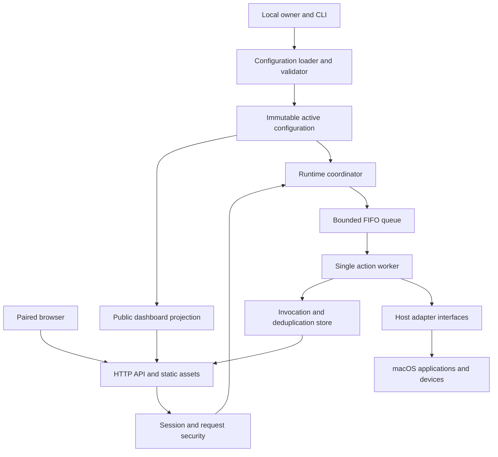
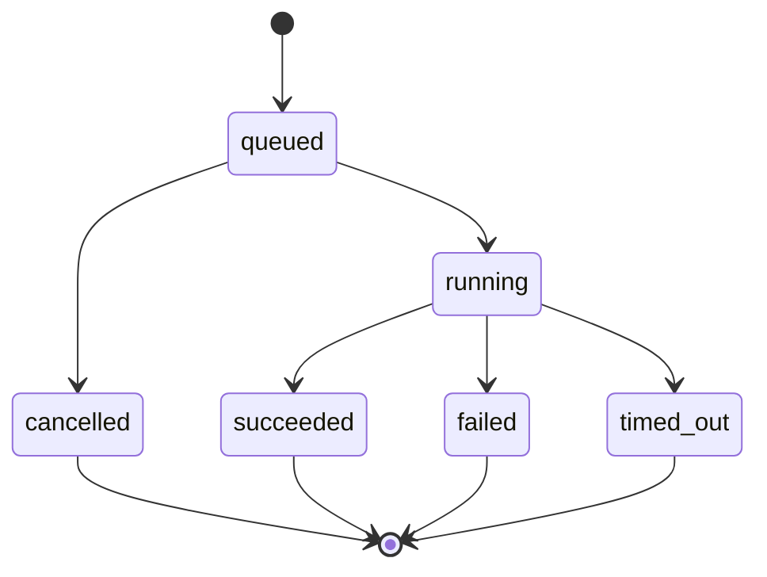

# Conty — draft technical implementation overview
Draft v0.1 · 19 October 2026 · companion to the [draft project specification](conty-draft-spec.md)

## 1. Purpose and status

This document describes how to implement Conty as a local host service with a browser-based remote control panel. It translates the product specification into component boundaries, data flows, execution rules and an incremental delivery plan without prescribing every class, function or library.

The [draft project specification](conty-draft-spec.md) remains the source of product requirements and YAML semantics. This document primarily proposes an implementation approach. Milestone 1 adapters and a local CLI now exist; their current contract and pending hardware acceptance are documented in the [host-control guide](milestone-1-host-control.md). The YAML loader, server and dashboard remain Milestone 2 work. Proposed defaults, additional routes and local management commands should be confirmed during implementation and recorded in the public documentation before release.

The initial target is a MacBook controlled from iPhone Safari on a trusted private LAN. One service instance controls one host, runs as its logged-in user and accepts multiple paired browsers. Windows/Linux adapters, stateful widgets, sequences and public internet deployment are not part of the MVP.

## 2. Architectural approach

Build one application with clearly separated internal modules rather than several independently deployed services. The host serves local web assets, validates configuration, authenticates clients and coordinates a single action executor. Platform-specific code sits behind an adapter boundary.



The key boundary is between a **declarative client** and an **authoritative host**. The browser renders a dashboard and requests a named action. Only the host decides what that action means, whether it is available and how it executes. No executable path, script, environment value or arbitrary command parameter is accepted from a browser.

Keep the API, scheduler and runtime state in one operating-system process initially. A short-lived helper or subprocess may perform a particular native operation where isolation is necessary, but it must not become an independent source of scheduling or authorization decisions.

### Core responsibilities

| Component | Owns | Must not own |
| --- | --- | --- |
| Configuration subsystem | YAML parsing, validation, normalization, immutable revisions and public projections. | Sessions, execution history or live device state. |
| HTTP layer | Transport validation, authentication, serialization and static assets. | Native automation or its own execution queue. |
| Runtime coordinator | Atomic admission/reload decisions, active revision, FIFO queue and invocation transitions. | Dashboard rendering or OS-specific commands. |
| Session manager | Pairing, session verification, expiration and revocation. | Configuration editing or execution policy hidden in routes. |
| Action worker | One-at-a-time dispatch, deadlines and recording results. | Reinterpreting raw YAML or trusting browser-supplied action definitions. |
| Host adapters | Capability checks, target resolution and native operations. | HTTP responses, cookies or browser state. |
| Browser renderer | Navigation, explicit grids, connection state and invocation feedback. | Host permissions, command construction or inferred application state. |

## 3. Proposed technology choices

Use Python for the prototype host and plain HTML, CSS and JavaScript for the browser. This follows the specification's proposed direction and keeps the first implementation small enough to inspect and distribute without a separate frontend build system.

| Area | Proposed choice | Rationale and qualification |
| --- | --- | --- |
| Host runtime | A supported Python 3 release, pinned through project metadata. | Good CLI, process and testing support; validate compatibility with the chosen macOS bridge before fixing the minimum version. |
| HTTP server | FastAPI on Uvicorn, one worker process. | Typed request/response models and asynchronous polling support without introducing a separate service. |
| Typed models | Pydantic models with strict validation and forbidden extra fields. | Separate validated configuration models from public API models. |
| YAML | A safe parser with source-location support, such as `ruamel.yaml`, configured to reject duplicate keys. | Useful field-level diagnostics; add explicit resource and tag restrictions rather than assuming safe mode handles every limit. |
| Browser | Local static assets, CSS Grid and the Fetch API. | Sufficient for pages, buttons and polling; no framework is required for the MVP. |
| macOS bridge | Evaluate PyObjC/native APIs and narrowly scoped automation helpers during the host-control spike. | Choose based on focus reliability, permission behavior and distribution constraints, not convenience alone. |
| Tests | `pytest`, API integration tests and browser automation where practical. | Native effects still require a documented test on the actual MacBook. |
| State | In-memory bounded stores. | No database is needed for the prototype; restart semantics must remain explicit. |

These are recommendations, not a requirement to adopt every dependency immediately. Pin compatible dependency versions once the native spike succeeds. Do not introduce WebSockets, a message broker, a plugin package ecosystem or an ORM unless a demonstrated requirement justifies them.

**Run exactly one application worker.** Multiple web workers would otherwise create independent queues, sessions and active revisions, breaking host-wide ordering. Development auto-reload is not the configuration reload mechanism and must not be used for normal service operation.

## 4. Proposed code organization

A possible initial repository structure is:

```text
pyproject.toml
src/conty/
  cli.py
  config/          # Parsing, schema, diagnostics, normalization and projection.
  server/          # HTTP routes, request security and response models.
  runtime/         # Coordinator, queue, invocation state and bounded stores.
  auth/            # Pairing codes, sessions and rate limiting.
  adapters/
    base.py        # Platform-independent contracts and error categories.
    macos/         # Keyboard, Apple Music, audio and permission support.
    process.py     # Direct child-process execution and cleanup.
  web/             # Packaged HTML, CSS and JavaScript.
tests/
  unit/
  integration/
  browser/
examples/
documentation/
```

This is a proposed layout, not a request to scaffold all modules before they are needed. Keep public API models separate from internal configuration models so a serialization change cannot accidentally disclose an action's implementation.

Dependencies should point inward: routes call the coordinator; the coordinator uses validated models and adapter contracts; adapters do not import routes. Supply adapters and clocks through explicit construction so tests can replace them without accessing the real desktop.

## 5. Configuration as a compilation pipeline

Treat YAML as source input that is compiled into an immutable runtime snapshot. No request handler or adapter should parse YAML during execution.

### Load and validate

1. Read a bounded file from a local owner-selected path. Preserve the source path and diagnostic locations.
2. Parse safely; reject duplicate mapping keys, custom/executable tags and excessive nesting or alias expansion. Enforce structural limits as well as file size.
3. Validate the supported integer schema version and strict field types. Reject unknown fields rather than silently ignoring spelling mistakes.
4. Validate each discriminated action type and widget type. Check timeout bounds, key/modifier names, media commands, volume operations and process argument structure.
5. Resolve IDs and references. Action IDs are global; proposed scopes for other IDs are dashboard IDs globally, section IDs within a dashboard and widget IDs within a section. Document these scopes in the version-1 schema.
6. Validate grid bounds and overlaps, including each widget's full span. Require explicit coordinates; do not introduce automatic placement.
7. Resolve supported relative paths against the configuration directory and normalize defaults, spans and widget navigation order.
8. Check host support for the configured action types and media targets. Separate unsupported configurations from temporarily unavailable apps, permissions or output devices.
9. Produce the immutable internal snapshot and a separately constructed public dashboard projection.

Return multiple useful diagnostics when possible, each with a field path, explanation and line/column where available. For example, an overlap error should identify both widgets rather than just report an invalid section.

Configuration validation must not execute actions or trigger permission prompts. An installed-but-not-running player or missing permission is an operational readiness issue, not the same as an unsupported adapter. A diagnostic command can report these conditions separately.

### Normalized internal representation

A snapshot contains the schema version, an opaque runtime revision, normalized action definitions, ordered dashboards and the source directory needed for path resolution. Request handling uses this snapshot, not mutable parser objects.

Generate a fresh revision on startup and every successful reload, even if the file contents happen to match a previous version. Use an opaque random identifier rather than a hash of configuration contents; the revision identifies an activation, not the contents of potentially sensitive configuration.

Resolve relative working directories and script paths against the configuration directory, as required by the product specification. Since `argv` may contain ordinary strings as well as paths, do not guess which arbitrary arguments are filenames or assume that changing the child working directory resolves this when an explicit `cwd` is present. Before freezing version 1, define an explicit script-path representation that the loader can normalize into interpreter arguments, or a documented set of unambiguous interpreter invocation forms. This is a schema clarification to resolve alongside the product specification, not a reason to require absolute script paths or silently reinterpret arbitrary arguments. Bare executable names, if supported, should be resolved against a controlled host `PATH`, with the resolved executable recorded locally.

### Public projection

The browser receives titles, IDs, labels, appearance tokens, grid dimensions, normalized positions, action references and the active revision. It does not receive raw YAML, process arguments, local paths, environment mappings, automation source or process output.

Build this projection with an explicit allowlist of fields. Do not serialize the internal model and try to remove sensitive fields afterward. Keep live capability and permission status separate from the configuration itself.

## 6. Host lifecycle and local management

### Startup

1. Resolve the configuration and local state paths; initialize bounded logging without dumping configuration or inherited environment values.
2. Load and validate the initial snapshot. Exit with diagnostics if it is invalid; there is no older running revision to preserve on first startup.
3. Initialize adapters, runtime stores, the coordinator and the single execution worker.
4. Bind the configured interface and port. Loopback is the default; LAN binding is an explicit owner decision.
5. Report local connection information and, for LAN mode, usable candidate LAN URLs. Do not present `0.0.0.0` as a phone destination.
6. Generate a short-lived pairing code and display it locally with a QR code containing the connection URL, not a session credential.

The service must run in the logged-in user's interactive desktop context. A system daemon or root service is not a shortcut around macOS input and Automation permissions. Prevent accidental duplicate Conty instances for the same managed host context, and fail clearly on a port or instance-lock conflict.

### Owner-only operations

Keep reload, pairing-code rotation and session revocation local. In addition to the specified `validate` and `serve` commands, propose local management operations such as `reload`, `pairing-code`, `sessions list`, `sessions revoke` and `doctor`; their exact command syntax remains to be defined.

A small local management channel is sufficient. On macOS, a Unix-domain socket in an owner-only runtime directory can connect the CLI to the running service. Restrict its filesystem permissions, verify the connecting user where supported and never expose this channel through the LAN HTTP API. Do not make a browser-accessible configuration editor or administrative execution endpoint.

### Shutdown and restart

Stop admitting requests, cancel queued work and give the active invocation a bounded shutdown period. If necessary, attempt the same cleanup used for a timeout. Close adapters and the local management channel afterward.

For the first release, keep sessions and invocation state in memory. A restart invalidates pairings and cannot prove the outcome of previously running work. Require pairing again, never replay old commands and make this limitation clear in setup instructions.

## 7. Runtime data model and atomicity

Use a small set of explicit runtime records:

| Record | Important fields |
| --- | --- |
| Configuration snapshot | Revision, schema version, action map, dashboards and public projection. |
| Session | Opaque internal ID, credential digest, creation/expiry timestamps and revocation state. |
| Invocation | Server ID, owning session ID, client request ID, action ID, revision, state, timestamps, deadline and sanitized result. |
| Deduplication entry | Session/request key, submitted payload identity, invocation ID and retention deadline. |
| Capability report | Adapter/type support, permission readiness, target/device availability and observation time. |

Use wall-clock timestamps for display and audit records, and monotonic time for deadlines, rate limits and retention. An invocation retains the action definition or snapshot reference it was admitted against; it must never resolve its action from whichever revision happens to be current later.

The coordinator serializes admission, dequeue/start, reload and revocation decisions with one short-lived lock or equivalent event-loop ownership. No native operation, network wait or process wait occurs while this coordination lock is held.

This is essential for race safety: a request must not pass a revision check and then enter the queue after that revision has been replaced. Likewise, a worker must not start a queued invocation at the same instant a reload cancels it.

## 8. Invocation admission and ordering

For every submission:

1. Validate the Host, origin, content type, request size, session and CSRF protection before accessing action data.
2. Validate the request shape: request ID, action ID and configuration revision only. Reject unknown input fields and bound identifier lengths.
3. Within the coordinator, look up the session/request pair in the deduplication store. The same ID and payload return the existing record; the same ID with a different action or revision is a conflict.
4. For a new request, require the active revision, a configured action and an adapter that can attempt execution. Enforce submission rate limits and available queue/store capacity.
5. Atomically allocate an invocation ID, register deduplication state and append to the FIFO queue.
6. Return acceptance immediately with the invocation ID and current state. Acceptance is not confirmation that the host action completed.

Check existing deduplication records before rejecting a stale revision so a retry can retrieve the original outcome after reload without causing another execution. Authentication and abuse protection still apply to duplicate requests.

One worker consumes accepted invocations in admission order across all clients. Never run keyboard, media or volume operations concurrently in the MVP. A long process can therefore delay slide navigation; document this deliberate tradeoff rather than creating hidden priority rules.

The browser must also preserve intentional tap order. Maintain a small ordered submission pipeline: send the next tap after the previous submission is acknowledged, not after its action finishes. This allows rapid navigation without depending on parallel HTTP arrival order. Bound this pipeline, stop draining it when connection certainty is lost and never persist unsent taps for later replay.

### Proposed resource defaults

These are starting values to confirm through testing, not additions to the YAML schema:

| Resource | Proposed initial policy |
| --- | --- |
| Host execution | One running invocation and at most 64 queued invocations. |
| New submissions | Per-session burst of 20 and sustained allowance of 10 per second; separate host-wide protection. |
| Deduplication/status retention | Keep every nonterminal invocation; retain terminal request records for at least 15 minutes after completion. |
| Request-record capacity | 10,000 retained records; reject new work when necessary rather than evict unexpired guarantees. |
| Local detailed history | Most recent 1,000 records with bounded diagnostic/output payloads. |
| Process output | At most 64 KiB retained per stream; continue draining excess output without retaining it. |
| Pairing | Code valid for 2 minutes, consumed on success; limit attempts per source and across the host. |
| Sessions | Fixed 8-hour lifetime for the prototype, revocable locally. |

Detailed history can expire before a deduplication record. Keep a compact status record for the full promised retention window so history eviction cannot cause duplicate execution. Apply request/size/rate limits to pairing, polling and unauthenticated traffic too; protect the service before allocating large per-client state.

## 9. Execution states, deadlines and cleanup

The normal invocation lifecycle is:



`cancelled` is a proposed additional terminal state for work removed before it starts, particularly during reload, session revocation or shutdown. This distinguishes “not attempted” from failure after dispatch. No browser cancellation endpoint is required for the MVP.

A configured action timeout starts when execution begins, not when it joins the queue. Record queue wait and execution duration separately. A deadline is not an undo mechanism: a key may already have been delivered, a player may have responded or a script may have made external changes.

Adapter results should distinguish confirmed failure before dispatch from failures or timeouts with possible side effects. Include an effect-certainty field or equivalent sanitized indication when an operation may have reached the host but completion cannot be established.

### Keeping the service responsive

Blocking OS bridges and child-process waits must not run directly on the HTTP event loop. Use asynchronous process management or a dedicated execution context with bounded operations.

A timeout on a thread await does not stop its native operation. Where native calls cannot be bounded or cancelled reliably, use a supervised helper process or another tested isolation mechanism. Do not start the next action while the previous execution context may still issue delayed input. If the executor cannot be safely recovered, mark it unavailable, reject new work and provide a local diagnostic rather than silently violating single-action ordering.

### Process cleanup

Start a configured executable directly with its argument array, without an implicit shell. Establish a process group/session for cleanup, drain stdout/stderr concurrently and retain only bounded output. Use a documented minimal inherited environment plus configured `env_from` mappings; resolve those mappings on the host and never expose their values.

On timeout or forced shutdown, request termination of the process group, wait a short grace period, then attempt forceful termination and reap the child. Record whether cleanup succeeded. Detached descendants and external effects may remain; neither a successful termination attempt nor a process exit proves those effects were undone.

A zero exit status means the configured process exited successfully. For a launcher such as `/usr/bin/open`, it does not prove that PowerPoint is ready for input or showing a slideshow.

## 10. macOS adapter strategy

Start by proving the native behaviors independently of the web UI. The adapter interface should accept a normalized action plus execution context and return a structured result. It should also expose support/readiness checks without performing the action.

Suggested error categories include `permission_denied`, `target_unavailable`, `target_not_frontmost`, `capability_unavailable`, `execution_failed`, `timed_out` and `executor_unavailable`. Do not make callers interpret raw AppleScript messages or native numeric codes.

### Keyboard input and focus

Keyboard input is generalized. `app_id` defaults to `None`: snapshot the current frontmost running application and PID when execution starts, without activation or later retargeting. An explicit app ID resolves exactly one already-running application by bundle identifier; it never launches the app. PowerPoint is only an explicitly targeted reference example (`conty keyboard right --app-id com.microsoft.Powerpoint`); verify its identifier on the actual machine.

Adapter/CLI `focus` defaults to `None`, choosing no activation for a frontmost snapshot and `activate` for an explicit app ID. Explicitly supplying a focus policy without an app ID is `invalid_action`. For an explicit target, `activate` requests activation and waits for bounded frontmost confirmation; `require_frontmost` checks without activating. Immediately before dispatch, recheck PID/termination, focus, permission and deadline; fail closed if a check fails.

Translate the public `SUPPORTED_KEYS` tuple's physical ANSI vocabulary and optional `shift`, `control`, `option`, `command` modifiers into paired native key-down/key-up events with modifier cleanup. The [draft specification](conty-draft-spec.md#6-initial-actions) lists the letter, digit, named punctuation, navigation, function and keypad keys. Physical positions are layout-dependent, not Unicode text typing. Test a harmless non-PowerPoint app as well as PowerPoint's slideshow window and an attached presentation display.

Deliver with `CGEventPostToPid`, never global event posting or a silent global fallback. PID-directed delivery avoids intentionally sending input to another frontmost app but does not eliminate lifecycle/focus races or prove that the target accepts synthetic events. Do not claim a preflight check alone guarantees isolation. If safe targeting cannot meet the requirement, revise the adapter approach before shipping.

Report success as “input dispatched,” not “slide advanced” or “screen is black.” Conty has no observed presentation state in the MVP.

### Apple Music playback

Implement a dedicated adapter for the supported Apple Music bundle ID and the three named commands. Evaluate application-directed Apple Events/AppleScript without activating Music; do not fall back to global media keys or another player.

Use fixed command templates or native calls with validated identifiers, never browser-generated automation source. An unavailable player should return a target error rather than silently launching or switching players. Check that target availability and automation do not accidentally auto-launch Music through the chosen scripting mechanism.

Automation permission may be specific to the controlling application and target. A denied request must be surfaced as a permission failure, not retried repeatedly in a way that causes prompt loops.

### System output volume and mute

Resolve the default output device when each action starts. Through the chosen Core Audio bridge, inspect whether the relevant volume/mute properties are supported and writable before attempting a change.

For adjustment, read actual volume, add the configured signed percentage-point delta and clamp to 0–100 while preserving mute. For mute, read and invert actual mute without changing the stored volume. Do not cache a guessed value between button presses.

Some devices expose no software control, only channel-specific properties or behavior that cannot meet these semantics. Define the supported mapping during the spike; reject unsupported cases clearly rather than changing unrelated channel gains or reporting false success. Bind each operation to the resolved device and fail safely if it disappears mid-operation.

Read/modify/write is serialized among Conty actions, but external system controls can still change volume concurrently. The MVP does not promise a transaction across the whole operating system or a live volume readout.

### Permissions and application identity

Accessibility and Automation requirements depend on the selected APIs. The diagnostic flow must identify the missing permission, controlling executable/application identity and relevant System Settings guidance. Permission prompts should occur only in a deliberate local setup/test flow, not as a side effect of remote requests or ordinary validation.

Development through a terminal and a packaged application may have different permission identities. Validate the eventual launch method and packaging early; document that a changed installation or identity may require renewed permission approval. Run without automatic elevation.

## 11. HTTP API and browser contract

Keep the initial API small and polling-based. Serve the browser and API from the same origin, with no external fonts, icons, scripts or analytics.

| Endpoint | Proposed contract |
| --- | --- |
| `POST /api/pair` | Accept a temporary pairing code, set a session cookie and establish CSRF protection. Return no host action definitions. |
| `GET /api/dashboard` | Return the authenticated public projection and active revision. |
| `POST /api/invocations` | Accept `{ request_id, action_id, revision }`; return `202` for newly accepted work and the existing record for a recognized duplicate. |
| `GET /api/invocations/{id}` | Return a sanitized invocation record only to its owning session. |
| `GET /api/requests/{request_id}` | Proposed recovery route: find the owning session's retained invocation when the submission response was lost. |
| `GET /api/status` | Return active revision, coarse readiness/permission information and executor availability, not other clients' history. |

The request-ID lookup extends the conceptual API in the specification. It solves an important ambiguity: after a lost POST response, the client may know its request ID but never have received the server invocation ID. A read-only lookup can recover the result without resubmitting the command.

Return a consistent error envelope with a stable error code, safe human-readable message and correlation ID. Use appropriate HTTP status codes: authentication failure, forbidden mutation, invalid input, stale-revision conflict, rate limiting and temporary queue/executor unavailability must be distinguishable. Queue-full or capacity errors mean the new action was not accepted; do not silently retain it for later execution.

A stale-revision response should identify the active revision and direct the browser to fetch the new dashboard, without executing the old request. Unauthorized or cross-session invocation lookups should not reveal whether another client's invocation exists.

Poll invocation status while relevant work is outstanding and poll overall status at a modest interval. Suggested starting intervals are 250–500 ms for active invocations and 2 seconds for readiness, with backoff and jitter after failures. Bound concurrent polls and reduce activity in background tabs.

## 12. Pairing and request security

Pairing is the authorization boundary for all dashboard, action and status data. The unauthenticated page may load static assets and a pairing form, but must not embed host configuration or action information in its HTML.

Generate codes and session credentials with a cryptographically secure random source. Show pairing codes only through local owner-controlled output; never log them to general request logs or put them in URLs. A short numeric code needs short expiry and strict throttling because its entropy is limited.

Use an opaque cookie credential with `HttpOnly`, `SameSite=Strict`, an explicit path and no broad Domain attribute. Store a digest rather than the raw session secret. Require `Secure` cookies under HTTPS; explicitly document that trusted-LAN HTTP cannot protect credentials from interception and cannot use the same secure-cookie guarantees.

For authenticated mutations, require both an allowed origin and a session-bound CSRF token in a custom header. Reject missing or untrusted browser mutation origins. Pairing has no existing session token, so protect it with strict origin checks, JSON-only requests, accepted content types and attempt limits. Do not enable permissive CORS.

Validate Host values against an explicit set of approved hostnames/IPs and ports derived from the local deployment settings. LAN interface discovery is a way to suggest connection addresses, not permission to accept arbitrary DNS names. This reduces DNS-rebinding risk. If TLS terminates at a reverse proxy, explicitly configure trusted proxy peers; do not blindly trust forwarded Host or client-IP headers.

Use a restrictive Content Security Policy suitable for local scripts and same-origin API calls, disallow framing and avoid inline script requirements. Apply body-size limits and safe response caching. Authenticated API responses should not be stored in shared caches; never place session secrets in browser local storage.

Local session revocation invalidates further requests and cancels that session's queued work atomically. An already running action may finish or leave effects; revocation is not rollback. Expired or revoked clients return to pairing and must not be silently reauthorized.

HTTP on a trusted private LAN is an explicit initial compromise, not a claim that the LAN is secure. Document HTTPS through a locally trusted certificate or controlled reverse proxy as a deployment path, including how the phone trusts the certificate. Do not advertise public or untrusted-network use before that path and its security configuration are tested.

## 13. Dashboard rendering and interaction

Render from the public model using a small registry of supported widget types; the MVP registry contains buttons only. Unknown public model/widget versions should produce a clear incompatibility message, not a partially guessed interface.

For each dashboard, render sections vertically in configuration order. Within a section, create the declared CSS Grid rows and columns, place every widget explicitly and preserve empty cells and spans. Sort DOM order by starting row, then column so keyboard traversal matches the specified navigation order rather than YAML declaration order.

Use minimum usable cell dimensions, large touch targets and a horizontally scrollable section wrapper when the grid cannot fit. Do not change the configured number of columns or auto-stack widgets at phone breakpoints. Label scrollable regions accessibly and ensure focused controls can be scrolled into view.

Use real buttons, visible focus indicators, accessible labels and restrained status announcements. Render labels as text, not HTML, and map appearance names to a finite set of local CSS classes. Do not accept arbitrary CSS or markup from the configuration in the MVP.

### Interaction state

Maintain separate state for:

- **Connection:** pairing required, connected, reconnecting or unreachable.
- **Configuration:** active revision, refreshing or incompatible.
- **Invocation:** submitting, queued, running and terminal result.

Keep intentional rapid presses possible; do not disable Next until the previous action finishes. Show pending counts or concise per-button feedback while retaining each invocation identity. Stop accepting more taps when the local submission bound is reached or the browser knows it cannot submit safely.

Do not optimistically show blackout, playback or mute as a known on/off state. A successful command is an execution result, not an observed state binding.

Keep-awake is optional progressive enhancement. Ordinary HTTP LAN pages cannot promise Screen Wake Lock because it requires a secure context. Browser fullscreen behavior also varies, particularly on phones; the layout must work without either feature.

## 14. Reload and reconnection behavior

### Atomic reload

Parse, validate and prepare a candidate snapshot outside the coordination lock while the active system continues running. If any step fails, report the diagnostics locally and retain the existing revision unchanged.

For a valid candidate, enter the coordinator and atomically:

1. Publish the new snapshot and public projection.
2. Mark queued invocations from the previous revision as `cancelled`, with a `configuration_reloaded` reason.
3. Preserve their request records so retries cannot re-execute them.
4. Allow the already running invocation to finish using its captured definition.

Subsequent old-revision submissions are rejected. Status polling reveals the new revision; the browser refreshes the dashboard, clears unsent old-revision taps and preserves the selected dashboard only if its ID still exists. It must not reinterpret an old tap against a new action definition.

Treat listening address, port and authentication/deployment policy as restart-required settings initially. Reject a hot reload that attempts to change them and explain the required restart, rather than claiming all settings changed atomically while the old socket remains active.

### Lost connection

When a submission response or status poll fails, stop sending queued local taps and show the connection problem. Do not automatically retry a POST, even with its original request ID. Resume only read-only session/status checks and lookups for already submitted request IDs.

If a retained record exists, display its actual status. If no record can establish the outcome, show **outcome unknown**. An expired retention window, service restart, session loss or request that never arrived cannot be safely distinguished by guessing. An explicit new user tap is a new request, not an automatic repair of the unknown one.

Deduplication prevents re-execution only for recognized session/request pairs within the documented retention policy. It is not an exactly-once delivery guarantee across expiry, restart or effects performed before a crash.

## 15. Diagnostics, logging and operational feedback

Use structured local records for startup, configuration revision changes, pairing/session lifecycle, action admission and terminal results. Record action ID, invocation ID, revision, timestamps, queue wait, execution duration and normalized error category.

Never record cookie values, CSRF tokens, pairing codes, inherited environment values or full configuration by default. Process arguments and stdout/stderr may contain secrets; treat bounded output as local-only sensitive diagnostics with restrictive access, not ordinary audit fields or API response data.

Keep both retained records and on-disk logs bounded. A verbose diagnostic mode must be explicit and documented, including where potentially sensitive output is stored. Stable correlation IDs should let a phone error be matched to the local record without exposing host details to the phone.

The proposed `doctor` flow should report adapter support, permission readiness, target availability and audio-device limitations. Separate passive inspection from an explicit action test that may move focus, play media or change volume. A passive health check must not send keystrokes or trigger a permission prompt.

## 16. Validation strategy

Build tests around the boundaries and failure semantics, not just successful button clicks. Most tests should use fake adapters and deterministic clocks; the real OS proof is a separate required acceptance step.

| Layer | Important coverage |
| --- | --- |
| Configuration | Duplicate keys/IDs, strict fields/types, schema versions, resource limits, references, paths, spans, bounds, overlaps and useful diagnostics. |
| Public projection | No executable paths, arguments, environment mappings, automation source or process output in any API response. |
| Coordinator | FIFO across clients, duplicate requests, payload conflicts, queue saturation, deadlines, capacity limits and retained records. |
| Race conditions | Admission versus reload, dequeue versus cancellation, session revocation versus dispatch and concurrent duplicate submissions. |
| Process execution | Direct argument handling, no implicit shell, environment restrictions, output draining, nonzero exits, timeout cleanup and service responsiveness. |
| Security/API | Pairing expiry/throttling, cookie attributes, CSRF/origin/Host checks, body limits, session ownership, revocation and unauthenticated data denial. |
| Browser | Explicit grids/spans/empty cells, traversal order, narrow viewport scrolling, rapid-tap ordering, revision refresh and unknown outcomes without retries. |
| macOS acceptance | Frontmost snapshots without activation, non-PowerPoint physical keys/layouts, termination/focus changes before dispatch, explicit PowerPoint/display setup, Apple Music targeting, selected audio device, volume/mute semantics and denied permissions. |

Use generated layout cases where helpful to exercise overlap/bounds invariants. Test that a recognized duplicate can still be looked up after reload and that capacity pressure never evicts an unexpired deduplication promise.

Verify the prototype with the actual MacBook, iPhone Safari and presentation display. Include sleep/wake, Wi-Fi loss, browser backgrounding, unavailable applications, permission changes, output-device changes and a timed-out process. Document OS/application versions and distinguish automated coverage from manual acceptance evidence.

## 17. Delivery sequence and gates

### Milestone 1 — prove host control

Implement minimal adapter experiments and a local diagnostic/test entry point before the complete server or renderer.

Deliver generalized physical keyboard input with frontmost snapshots and explicit application targeting, PowerPoint reference activation/next/previous/blackout, direct process invocation, application-targeted Apple Music commands and selected-device volume/mute. Exercise missing permissions, absent targets and unsupported devices. Resolve the controlling application identity and focus-delivery approach early.

**Gate:** the actual presentation and media use cases work on the target hardware, and unsafe or unsupported cases fail honestly. If reliable targeting requires app-specific automation or a native helper, make that decision now rather than concealing it behind a generic keyboard API.

### Milestone 2 — minimum usable dashboard

Add the typed configuration pipeline, public projection, same-origin server, pairing, session checks, bounded FIFO dispatcher and plain browser renderer. Ship the presentation and media examples and basic invocation polling.

**Gate:** an offline iPhone can pair and control both dashboards, explicit layout is preserved, unpaired access is denied and deliberate rapid navigation executes in admitted order. Include safe admission and deduplication foundations here even if the full reconnect experience arrives next.

### Milestone 3 — dependable daily use

Complete atomic reload, local session management, request-ID recovery, retention/capacity enforcement, permission guidance, diagnostic redaction, process cleanup and packaging. Exercise restart and lost-response behavior explicitly.

**Gate:** meet the draft specification's full acceptance criteria, including stale-revision handling, unknown outcomes, timeout responsiveness, bounded resources and no secret/history leakage. Do not treat authentication, safe native dispatch or failure semantics as optional post-release hardening.

## 18. Packaging and setup

Package the host and local web assets together and pin the dependencies used to build/test a release. A virtual-environment installation is sufficient for the developer prototype; evaluate a packaged macOS application or executable only after checking native bridge requirements and permission identity.

Provide one setup guide covering configuration, validation, deliberate LAN binding, pairing, permissions, starting/stopping, reload, session revocation and troubleshooting. Explain host firewall access, Wi-Fi client isolation, candidate LAN URLs and the fact that the computer must remain awake, reachable and in a usable desktop session.

Do not install a privileged background service by default. If a user-level launch mechanism is added, ensure it preserves the correct desktop context, environment policy, stable application identity and local diagnostics. Test startup from that mechanism rather than assuming behavior matches a development terminal.

Keep persistent user configuration separate from packaged assets and disposable runtime state. Do not overwrite the owner's YAML during upgrades. Document any future schema migration and make validation available before activating a migrated file.

## 19. Decisions to confirm during implementation

- **Native control:** which input mechanism reliably targets PowerPoint, and whether a helper or application-specific automation is required to satisfy focus safety.
- **Permission/distribution identity:** whether the Python launch path is suitable for daily use or a packaged native identity is needed earlier.
- **Schema details:** exact ID scopes, YAML integration of the public `SUPPORTED_KEYS` vocabulary and optional targeting rules, timeout field names/bounds, path resolution and controlled environment inheritance. Resolve these before publishing version 1.
- **Audio support:** which device/property combinations satisfy the specified volume and mute semantics, with a clear unsupported-device policy.
- **Operational limits:** final queue, rate, pairing, session, output and retention settings, based on measured behavior and documented guarantees.
- **Local management:** final CLI syntax and safe per-user management channel behavior.
- **HTTPS:** supported certificate/proxy setup and phone trust instructions before any untrusted-network deployment.
- **Future state model:** an explicit observed-state source before adding toggles, sliders or displayed playback/volume state.

Record resolved choices in small architecture decision notes where a tradeoff is significant. Keep later extensions behind the existing schema, coordinator and adapter boundaries rather than weakening the initial security and execution contract.
